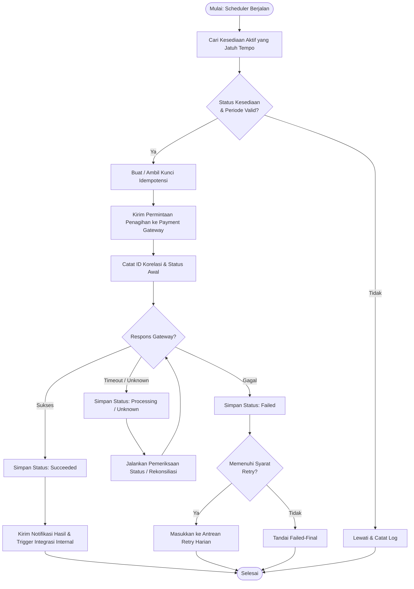
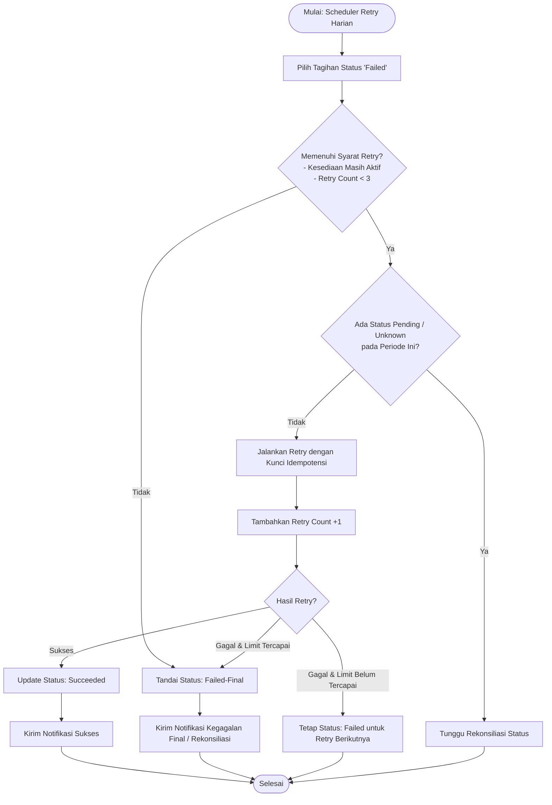

**  
  
DOKUMEN SPESIFIKASI KEBUTUHAN  
PERANGKAT LUNAK (SRS)**

**Baitulmal Tazkia  
Subsistem Donasi Berulang dan Kanal Pembayaran Digital**

| **Informasi Dokumen** | **Nilai**                                                               |
|-----------------------|-------------------------------------------------------------------------|
| Nama Proyek           | Donasi Berulang dan Kanal Pembayaran Digital                            |
| Klien/Lembaga         | Baitulmal Tazkia (Klaster Kanal dan Luring)                             |
| Standar Rujukan       | ISO/IEC/IEEE 29148:2018 (rujukan yang dicantumkan dalam dokumen sumber) |
| Nomor Dokumen         | SRS-BM-DONASI-01                                                        |
| Versi                 | Draft Revisi 1.1 — belum disahkan                                       |
| Tanggal               | 21 Oktober 2026                                                         |
| Status                | DRAFT UNTUK REVIEW — belum menjadi baseline resmi                       |

PENTING: Dokumen ini adalah draf hasil perapian dan pelengkapan
berdasarkan SRS sumber. Item bertanda \[KONFIRMASI\] atau \[ASUMSI\]
harus divalidasi oleh tim, dosen, dan/atau klien sebelum disahkan.

## **Daftar Isi**

[Lembar Review dan Pengesahan 4](#lembar-review-dan-pengesahan)

> [Riwayat Perubahan 4](#riwayat-perubahan)

[Daftar Isu yang Harus Dikonfirmasi
4](#daftar-isu-yang-harus-dikonfirmasi)

[1. Pendahuluan 4](#pendahuluan)

> [1.1 Tujuan 4](#tujuan)
>
> [1.2 Ruang Lingkup 4](#ruang-lingkup)
>
> [1.3 Di Luar Ruang Lingkup 5](#di-luar-ruang-lingkup)
>
> [1.4 Istilah dan Akronim 5](#istilah-dan-akronim)

[2. Deskripsi Umum 5](#deskripsi-umum)

> [2.1 Perspektif Produk dan Integrasi
> 5](#perspektif-produk-dan-integrasi)
>
> [2.2 Kelas Pengguna dan Hak Akses 5](#kelas-pengguna-dan-hak-akses)
>
> [2.3 Lingkungan Operasi 6](#lingkungan-operasi)
>
> [2.4 Asumsi dan Ketergantungan 6](#asumsi-dan-ketergantungan)

[3. Kebutuhan Antarmuka Eksternal 6](#kebutuhan-antarmuka-eksternal)

> [3.1 Antarmuka Pengguna 6](#antarmuka-pengguna)
>
> [3.2 Antarmuka Payment Gateway 6](#antarmuka-payment-gateway)
>
> [3.3 Antarmuka Subsistem Internal 6](#antarmuka-subsistem-internal)
>
> [3.4 Antarmuka Perangkat dan Jaringan
> 6](#antarmuka-perangkat-dan-jaringan)

[4. Spesifikasi Use Case 6](#spesifikasi-use-case)

> [4.1 UC-01 — Mendaftar Kesediaan Donasi Berulang
> 6](#uc-01-mendaftar-kesediaan-donasi-berulang)
>
> [4.2 UC-02 — Mengelola Kesediaan Donasi
> 7](#uc-02-mengelola-kesediaan-donasi)
>
> [4.3 UC-03 — Menjalankan Penagihan Terjadwal
> 7](#uc-03-menjalankan-penagihan-terjadwal)
>
> [4.4 UC-04 — Menjalankan Penagihan Ulang
> 7](#uc-04-menjalankan-penagihan-ulang)
>
> [4.5 UC-05 — Membuat dan Memantau Tautan Pembayaran Sekali Bayar
> 7](#uc-05-membuat-dan-memantau-tautan-pembayaran-sekali-bayar)
>
> [4.6 UC-06 — Mengirim Notifikasi 8](#uc-06-mengirim-notifikasi)

[5. Kebutuhan Fungsional 8](#kebutuhan-fungsional)

[6. Kebutuhan Nonfungsional 8](#kebutuhan-nonfungsional)

[7. Aturan Bisnis 9](#aturan-bisnis)

[8. Model Status dan Transisi 9](#model-status-dan-transisi)

[9. Data dan Integritas 10](#data-dan-integritas)

[10. Requirements Traceability Matrix (RTM)
10](#requirements-traceability-matrix-rtm)

[11. Rencana Pengujian dan Kriteria Penerimaan
11](#rencana-pengujian-dan-kriteria-penerimaan)

[12. Manajemen Risiko 11](#manajemen-risiko)

[13. Cutover, Operasi, dan Rollback 11](#cutover-operasi-dan-rollback)

> [13.1 Checklist Cutover 11](#checklist-cutover)
>
> [13.2 Kriteria Rollback 12](#kriteria-rollback)
>
> [13.3 Pemulihan 12](#pemulihan)

[14. Lampiran — Diagram Alur Teks 12](#_heading=h.nro7vp7rdd0y)

> [14.1 Alur Penagihan Berulang 12](#alur-penagihan-berulang)
>
> [14.2 Alur Retry 12](#alur-retry)

[15. Referensi dan Batas Dokumen 12](#referensi-dan-batas-dokumen)

# 

# Lembar Review dan Pengesahan

Versi ini belum merupakan persetujuan formal. Pengesahan hanya dilakukan
setelah ruang lingkup, kebutuhan, dan kriteria penerimaan ditinjau oleh
pihak yang berwenang.

| **Peran**                    | **Nama pada sumber**                           | **Status**                           |
|------------------------------|------------------------------------------------|--------------------------------------|
| Perwakilan klien             | \[KONFIRMASI: nama dan jabatan\]               | Belum ditandatangani                 |
| Dosen pembimbing/evaluator   | Endy Muhardin / Staff Pengajar (sesuai sumber) | Nama/jabatan/NIDN perlu diverifikasi |
| Ketua tim / Business Analyst | Fikri Pristyono Taufiqurrahman                 | NIM dan peran perlu diverifikasi     |

## Riwayat Perubahan

| **Versi**    | **Perubahan**                                                                                       | **Status**                                      |
|--------------|-----------------------------------------------------------------------------------------------------|-------------------------------------------------|
| 1.0-Baseline | Dokumen sumber (Workbook)                                                                           | Status baseline dan sign-off perlu diverifikasi |
| 1.1-Draft    | Penataan struktur, penambahan requirement, alur alternatif, NFR, RTM, risiko, dan daftar konfirmasi | Belum disahkan                                  |

# Daftar Isu yang Harus Dikonfirmasi

| **ID** | **Topik**                                   | **Hal yang perlu dipastikan**                                                                                                                |
|--------|---------------------------------------------|----------------------------------------------------------------------------------------------------------------------------------------------|
| K-01   | Identitas kelompok                          | Sumber menyebut Kelompok 5. Pastikan ini benar untuk dokumen yang sedang direvisi.                                                           |
| K-02   | Ketersediaan fitur Payment Gateway Artivisi | Konfirmasi apakah Artivisi benar-benar menyediakan tokenisasi/autodebit, retry, webhook, dan metode yang disebut.                            |
| K-03   | Batas retry                                 | Sumber menyebut retry harian dan batas maksimum 3 kali, tetapi belum jelas apakah tiga kali termasuk percobaan awal.                         |
| K-04   | Jadwal dan zona waktu                       | Konfirmasi zona waktu, tanggal jatuh tempo 29–31, akhir pekan, hari libur, dan tanggal yang tidak tersedia pada bulan tertentu.              |
| K-05   | Pembatalan/penundaan                        | Konfirmasi kapan perubahan berlaku, terutama jika penagihan sudah masuk antrean atau sedang diproses.                                        |
| K-06   | Tautan sekali bayar                         | Konfirmasi masa berlaku, nominal fleksibel/tetap, target donasi, batas penggunaan, dan siapa yang boleh membuat tautan.                      |
| K-07   | Notifikasi                                  | Konfirmasi kanal (email/WhatsApp/SMS/in-app), penyedia, biaya, dan aturan kegagalan pengiriman.                                              |
| K-08   | Integrasi dan kontrak API                   | Endpoint, autentikasi, signature webhook, idempotency, timeout, retry, serta format payload harus mengikuti dokumentasi vendor yang nyata.   |
| K-09   | Sumber RTM                                  | Rujukan 'Wawancara P4', 'Pertanyaan 6', 'Dugaan 3.1', 'Catatan Teknis 3.7', dan 'Risiko 3.6' harus dicocokkan dengan artefak asli.           |
| K-10   | Angka nonfungsional                         | Target performa, ketersediaan, kapasitas, RPO/RTO, dan retensi harus disetujui; angka tambahan tidak boleh dianggap komitmen tanpa validasi. |
| K-11   | Arsitektur 12 subsistem                     | Konfirmasi daftar subsistem, kontrak API, dan arah pertukaran data.                                                                          |
| K-12   | Pengesahan                                  | Nama, jabatan, NIK/NIM/NIDN, tanggal, dan pihak penandatangan perlu diverifikasi sebelum baseline.                                           |

# 1. Pendahuluan

## 1.1 Tujuan

Dokumen ini menetapkan kebutuhan perangkat lunak untuk Subsistem Donasi
Berulang dan Kanal Pembayaran Digital Baitulmal Tazkia. Dokumen menjadi
dasar diskusi kebutuhan, desain, implementasi, pengujian, dan penerimaan
setelah disetujui pemangku kepentingan.

## 1.2 Ruang Lingkup

- Pengelolaan kesediaan donasi berulang: pendaftaran nominal,
  program/peruntukan, tanggal penagihan, otorisasi instrumen pembayaran,
  status kesediaan, penagihan terjadwal, retry, notifikasi, serta
  penundaan/penghentian mandiri.

- Tautan pembayaran sekali bayar: pembuatan tautan unik oleh penggalang
  dana dan pemantauan akumulasi capaian donasi.12

\[KONFIRMASI\] Sistem tidak diasumsikan menyimpan dana atau memproses
dana sendiri. Eksekusi pembayaran dilakukan oleh Payment Gateway sesuai
kontrak layanan yang tersedia.

## 1.3 Di Luar Ruang Lingkup

- Penyelesaian settlement dan rekonsiliasi finansial akhir, yang menurut
  sumber merupakan tanggung jawab subsistem lain.

- Pengelolaan rekening/kartu secara langsung oleh subsistem ini; sumber
  menetapkan token pembayaran dari gateway sebagai data yang disimpan.

- Pengelolaan penuh CRM atau komunikasi donor di luar notifikasi yang
  terkait langsung dengan alur donasi. Batas pastinya perlu
  dikonfirmasi.

## 1.4 Istilah dan Akronim

| **Istilah**        | **Definisi kerja**                                                                                            |
|--------------------|---------------------------------------------------------------------------------------------------------------|
| SRS                | Software Requirements Specification.                                                                          |
| RTM                | Requirements Traceability Matrix; pemetaan kebutuhan ke sumber, desain, dan pengujian.                        |
| Recurring donation | Kesediaan donatur untuk memberikan donasi secara berkala dengan otorisasi sebelumnya.                         |
| Payment token      | Token yang diterbitkan payment gateway untuk mereferensikan instrumen pembayaran; bukan nomor kartu/rekening. |
| Idempotency key    | Kunci untuk mengenali permintaan yang sama agar pengulangan tidak menimbulkan transaksi ganda.                |
| Webhook            | Pemberitahuan status transaksi dari layanan eksternal ke sistem.                                              |
| Retry              | Percobaan ulang penagihan setelah kegagalan yang memenuhi aturan retry.                                       |
| RBAC               | Role-Based Access Control.                                                                                    |
| P95                | Persentil ke-95 dari distribusi waktu respons.                                                                |

# 2. Deskripsi Umum

## 2.1 Perspektif Produk dan Integrasi

Menurut dokumen sumber, subsistem merupakan bagian dari arsitektur
microservices dan berkomunikasi melalui REST API/OpenAPI. Integrasi yang
disebut adalah Payment Gateway Artivisi, Subsistem Penerimaan Donasi &
Akun Donatur, Subsistem Rekonsiliasi & Settlement, dan Subsistem
Hubungan Donatur & Komunikasi. Detail endpoint dan kontrak payload belum
tersedia dalam sumber dan harus dikonfirmasi.

## 2.2 Kelas Pengguna dan Hak Akses

| **Aktor/Peran**                | **Kebutuhan atau hak akses yang diharapkan**                                                   | **Status**                                                          |
|--------------------------------|------------------------------------------------------------------------------------------------|---------------------------------------------------------------------|
| Donatur                        | Mendaftar kesediaan; melihat status; menunda/menghentikan; mengubah peruntukan jika diizinkan. | Sebagian berasal dari sumber; detail autentikasi perlu dikonfirmasi |
| Penggalang dana                | Membuat tautan sekali bayar dan memantau capaian.                                              | Berasal dari scope; izin dan batasan perlu dikonfirmasi             |
| Payment Gateway Artivisi       | Menerima permintaan otorisasi/penagihan dan mengirim status transaksi.                         | Integrasi perlu divalidasi dengan vendor                            |
| Scheduler sistem               | Menjalankan penagihan jatuh tempo dan retry.                                                   | Berasal dari use case sumber                                        |
| Petugas/admin Baitulmal        | Mengelola fungsi administratif bila termasuk scope.                                            | ASUMSI — kewenangan belum dirinci dalam sumber                      |
| Sistem penerima/subsistem lain | Menerima atau mengambil data transaksi/status melalui API.                                     | Berasal dari perspektif integrasi sumber                            |

## 2.3 Lingkungan Operasi

Antarmuka pengguna direncanakan berbasis web responsif dan dapat diakses
melalui browser seluler maupun desktop. Teknologi frontend spesifik
belum ditetapkan; HTML5/CSS3/JavaScript Framework pada sumber merupakan
gambaran, bukan pilihan framework final.

## 2.4 Asumsi dan Ketergantungan

- Ketersediaan layanan Payment Gateway dan kontrak API yang sah
  merupakan ketergantungan eksternal.

- Pengiriman notifikasi bergantung pada kanal dan penyedia notifikasi
  yang akan dipilih.

- Identitas donatur dan hak akses harus dapat diverifikasi; mekanisme
  login belum ditentukan lengkap.

- Sumber menyebut REST API/OpenAPI, namun versi API, skema payload,
  autentikasi, dan SLA vendor belum dilampirkan.

# 3. Kebutuhan Antarmuka Eksternal

## 3.1 Antarmuka Pengguna

- Formulir pendaftaran donasi berulang.

- Dashboard donatur untuk melihat status dan mengelola kesediaan.

- Halaman tautan pembayaran sekali bayar.

- Tampilan status transaksi, hasil penagihan, serta pesan kesalahan yang
  dapat dipahami pengguna.

\[KONFIRMASI\] Desain visual, aksesibilitas, bahasa, dan dukungan
browser minimum belum ditetapkan.

## 3.2 Antarmuka Payment Gateway

- Registrasi/otorisasi token instrumen pembayaran jika layanan gateway
  mendukungnya.

- Permintaan penagihan berulang dan penerimaan status transaksi.

- Penerimaan webhook/callback yang diverifikasi keasliannya sebelum
  status transaksi diperbarui.

- Penanganan timeout, respons duplikat, respons terlambat, dan status
  yang belum pasti.

\[KONFIRMASI\] Nama endpoint, header autentikasi, signature, kode
status, batas laju, dan format payload harus diambil dari dokumentasi
resmi Artivisi; dokumen ini tidak mengarang kontrak tersebut.

## 3.3 Antarmuka Subsistem Internal

- Mengirim transaksi sukses ke Subsistem Penerimaan Donasi & Akun
  Donatur sesuai kontrak API.

- Menyediakan data penagihan berhasil dan gagal untuk kebutuhan
  Subsistem Rekonsiliasi & Settlement.

- Menyediakan status kesediaan yang diperlukan Subsistem Hubungan
  Donatur & Komunikasi.

\[KONFIRMASI\] Arah integrasi (push/pull), kebijakan pengulangan, skema
autentikasi, serta jaminan pengiriman perlu disepakati.

## 3.4 Antarmuka Perangkat dan Jaringan

Akses dilakukan melalui koneksi jaringan HTTPS. Kebutuhan perangkat
keras khusus tidak disebut dalam dokumen sumber.

# 4. Spesifikasi Use Case

## 4.1 UC-01 — Mendaftar Kesediaan Donasi Berulang

| **Atribut**         | **Spesifikasi**                                                                                                                                                                                                                                                                                                                                           |
|---------------------|-----------------------------------------------------------------------------------------------------------------------------------------------------------------------------------------------------------------------------------------------------------------------------------------------------------------------------------------------------------|
| Aktor utama         | Donatur                                                                                                                                                                                                                                                                                                                                                   |
| Aktor pendukung     | Payment Gateway Artivisi                                                                                                                                                                                                                                                                                                                                  |
| Tujuan              | Membuat kesediaan donasi berkala yang telah diotorisasi.                                                                                                                                                                                                                                                                                                  |
| Prakondisi          | Donatur teridentifikasi; layanan gateway tersedia; program donasi dapat dipilih.                                                                                                                                                                                                                                                                          |
| Pemicu              | Donatur memilih menu donasi berulang.                                                                                                                                                                                                                                                                                                                     |
| Alur utama          | 1\. Donatur membuka formulir. 2. Mengisi nominal, program, tanggal penagihan, dan metode yang didukung. 3. Sistem memvalidasi isian. 4. Sistem mengarahkan donatur ke proses otorisasi gateway. 5. Donatur menyetujui otorisasi. 6. Gateway mengembalikan hasil/token. 7. Sistem menyimpan referensi token, membuat ID kesediaan, dan menampilkan status. |
| Alur alternatif     | Jika isian tidak valid, sistem menandai bagian yang perlu diperbaiki. Jika donatur membatalkan otorisasi, kesediaan tidak diaktifkan.                                                                                                                                                                                                                     |
| Kegagalan           | Jika gateway timeout atau hasilnya tidak diketahui, sistem tidak boleh menganggap otorisasi berhasil; status perlu direkonsiliasi sebelum percobaan baru.                                                                                                                                                                                                 |
| Pascakondisi sukses | Kesediaan tersimpan dan aktif hanya setelah otorisasi berhasil terverifikasi.                                                                                                                                                                                                                                                                             |
| Pascakondisi gagal  | Tidak ada kesediaan aktif tanpa otorisasi yang sah.                                                                                                                                                                                                                                                                                                       |

## 4.2 UC-02 — Mengelola Kesediaan Donasi

| **Atribut**          | **Spesifikasi**                                                                                                                                                                                           |
|----------------------|-----------------------------------------------------------------------------------------------------------------------------------------------------------------------------------------------------------|
| Aktor utama          | Donatur                                                                                                                                                                                                   |
| Tujuan               | Melihat status, menunda, menghentikan, atau mengubah peruntukan sesuai aturan.                                                                                                                            |
| Prakondisi           | Donatur berhasil mengakses kesediaan miliknya.                                                                                                                                                            |
| Alur utama           | 1\. Donatur membuka daftar kesediaan. 2. Memilih satu kesediaan. 3. Memilih aksi yang tersedia. 4. Sistem memvalidasi hak akses dan waktu perubahan. 5. Sistem menyimpan perubahan dan menampilkan hasil. |
| Alternatif/kegagalan | Jika penagihan sedang diproses, sistem menampilkan status dan aturan yang berlaku; jangan menjanjikan pembatalan transaksi yang sudah dikirim ke gateway.                                                 |
| Pascakondisi         | Status dan jadwal diperbarui sesuai kebijakan yang telah disepakati.                                                                                                                                      |
| KONFIRMASI           | Apakah penundaan berarti melewati satu periode, mengubah tanggal, atau menghentikan sementara sampai tanggal tertentu? Kapan perubahan berlaku?                                                           |

## 4.3 UC-03 — Menjalankan Penagihan Terjadwal

| **Atribut**     | **Spesifikasi**                                                                                                                                                                                                                                                                                         |
|-----------------|---------------------------------------------------------------------------------------------------------------------------------------------------------------------------------------------------------------------------------------------------------------------------------------------------------|
| Aktor utama     | Scheduler sistem                                                                                                                                                                                                                                                                                        |
| Aktor pendukung | Payment Gateway Artivisi                                                                                                                                                                                                                                                                                |
| Prakondisi      | Ada kesediaan aktif yang telah mencapai tanggal penagihan dan memiliki token valid.                                                                                                                                                                                                                     |
| Alur utama      | 1\. Scheduler mencari tagihan jatuh tempo. 2. Sistem memeriksa status kesediaan dan periode tagihan. 3. Sistem membuat kunci idempotensi. 4. Sistem mengirim permintaan ke gateway. 5. Sistem mencatat ID permintaan dan status awal. 6. Status akhir diperbarui setelah respons/webhook terverifikasi. |
| Kegagalan       | Jika timeout, status dicatat sebagai belum pasti dan diperiksa melalui mekanisme status gateway yang tersedia; jangan langsung mengirim charge baru tanpa perlindungan duplikasi.                                                                                                                       |
| Pascakondisi    | Setiap periode memiliki catatan transaksi yang dapat ditelusuri.                                                                                                                                                                                                                                        |

## 4.4 UC-04 — Menjalankan Penagihan Ulang

| **Atribut** | **Spesifikasi**                                                                                                                                                                                                                                                                                                                      |
|-------------|--------------------------------------------------------------------------------------------------------------------------------------------------------------------------------------------------------------------------------------------------------------------------------------------------------------------------------------|
| Aktor utama | Scheduler sistem                                                                                                                                                                                                                                                                                                                     |
| Prakondisi  | Tagihan gagal dan memenuhi aturan retry; kesediaan belum dihentikan; batas retry belum terlampaui.                                                                                                                                                                                                                                   |
| Alur utama  | 1\. Scheduler memilih tagihan yang memenuhi syarat. 2. Memeriksa status kesediaan terbaru. 3. Memeriksa retry count dan periode. 4. Mengirim permintaan dengan kunci idempotensi yang sesuai kontrak gateway. 5. Mencatat hasil dan retry count. 6. Jika batas tercapai, tandai kegagalan final dan siapkan data untuk rekonsiliasi. |
| Kegagalan   | Jika respons belum pasti, sistem melakukan pemeriksaan status sebelum mengulang. Jika kesediaan sudah dihentikan, retry tidak dilakukan kecuali transaksi sudah terlanjur diproses dan memerlukan penanganan status.                                                                                                                 |
| KONFIRMASI  | Sumber menyebut maksimum 3 kali dan retry harian; definisi total percobaan perlu dipastikan.                                                                                                                                                                                                                                         |

## 4.5 UC-05 — Membuat dan Memantau Tautan Pembayaran Sekali Bayar

| **Atribut**          | **Spesifikasi**                                                                                                                                                                                                                                              |
|----------------------|--------------------------------------------------------------------------------------------------------------------------------------------------------------------------------------------------------------------------------------------------------------|
| Aktor utama          | Penggalang dana                                                                                                                                                                                                                                              |
| Prakondisi           | Pengguna terautentikasi dan berwenang membuat tautan.                                                                                                                                                                                                        |
| Alur utama           | 1\. Penggalang mengisi judul, target, dan parameter pembayaran yang disepakati. 2. Sistem memvalidasi data. 3. Sistem membuat URL unik. 4. Penggalang membagikan URL. 5. Sistem menampilkan akumulasi donasi berdasarkan transaksi yang telah terkonfirmasi. |
| Alternatif/kegagalan | Data tidak valid ditolak dengan pesan jelas. Transaksi pending tidak dihitung sebagai dana berhasil sampai status final terverifikasi.                                                                                                                       |
| KONFIRMASI           | Masa berlaku, nominal minimum/maksimum, target, batas pemakaian, dan penutupan tautan belum didefinisikan sumber.                                                                                                                                            |

## 4.6 UC-06 — Mengirim Notifikasi

| **Atribut** | **Spesifikasi**                                                                                                                                                                                                                   |
|-------------|-----------------------------------------------------------------------------------------------------------------------------------------------------------------------------------------------------------------------------------|
| Aktor utama | Scheduler/notifikasi sistem                                                                                                                                                                                                       |
| Pemicu      | Pengingat pra-penarikan atau hasil penagihan.                                                                                                                                                                                     |
| Alur utama  | 1\. Sistem menentukan peristiwa yang memerlukan notifikasi. 2. Sistem menyusun pesan tanpa membuka data sensitif yang tidak diperlukan. 3. Sistem mengirim melalui kanal yang dikonfigurasi. 4. Sistem mencatat hasil pengiriman. |
| Kegagalan   | Kegagalan penyedia dicatat dan ditangani sesuai kebijakan retry notifikasi; kegagalan notifikasi tidak boleh mengubah status pembayaran.                                                                                          |
| KONFIRMASI  | Sumber menyebut pengingat H-1 dan notifikasi pasca-penarikan, tetapi kanal, template, persetujuan komunikasi, dan kebijakan retry belum ditentukan.                                                                               |

# 5. Kebutuhan Fungsional

| **ID**      | **Nama**                      | **Pernyataan kebutuhan**                                                                                                           | **Kriteria penerimaan**                                                                                                     |
|-------------|-------------------------------|------------------------------------------------------------------------------------------------------------------------------------|-----------------------------------------------------------------------------------------------------------------------------|
| REQ-FUN-001 | Pendaftaran kesediaan         | Sistem harus menyediakan pendaftaran donasi berulang dengan nominal, periode, tanggal penagihan, dan program/peruntukan.           | Diberikan data valid dan otorisasi gateway berhasil; ketika pendaftaran selesai; maka ID kesediaan dibuat dan status aktif. |
| REQ-FUN-002 | Pengelolaan mandiri           | Sistem harus memungkinkan donatur melihat kesediaan dan melakukan penundaan/penghentian sesuai kebijakan.                          | Ketika aksi valid disimpan; status/jadwal berubah dan hasil ditampilkan.                                                    |
| REQ-FUN-003 | Penagihan terjadwal           | Sistem harus memproses tagihan jatuh tempo melalui gateway dengan token yang sah.                                                  | Ketika jadwal tiba; sistem membuat satu catatan tagihan per kesediaan dan periode.                                          |
| REQ-FUN-004 | Retry penagihan               | Sistem harus menjalankan retry harian hanya untuk tagihan yang memenuhi syarat dan belum mencapai batas.                           | Tagihan gagal memenuhi syarat; scheduler berjalan; percobaan dicatat dan tidak melampaui batas.                             |
| REQ-FUN-005 | Tautan sekali bayar           | Sistem harus membuat URL unik untuk pembayaran sekali bayar dan menyediakan pemantauan capaian.                                    | Tautan dibuat; URL unik tersedia dan capaian dihitung dari transaksi yang terkonfirmasi.                                    |
| REQ-FUN-006 | Perubahan peruntukan          | Sistem harus memungkinkan perubahan program donasi berulang jika diizinkan, dengan waktu berlaku yang jelas.                       | Perubahan disimpan; program baru diterapkan pada siklus sesuai aturan yang disepakati.                                      |
| REQ-FUN-007 | Pengingat pra-penarikan       | Sistem harus menjadwalkan pengingat H-1 sebelum penarikan sesuai kanal yang disetujui.                                             | Untuk tagihan yang memenuhi syarat; satu notifikasi pengingat dijadwalkan untuk periode tersebut.                           |
| REQ-FUN-008 | Notifikasi hasil              | Sistem harus mencatat dan mengirim notifikasi pasca-penarikan berdasarkan status yang terverifikasi.                               | Status final tersedia; notifikasi dibuat dengan status yang sama.                                                           |
| REQ-FUN-009 | Penerimaan webhook            | Sistem harus memverifikasi sumber/keaslian webhook dan mencegah event duplikat mengubah transaksi berulang kali.                   | Webhook valid diterima; status diproses satu kali secara logis; webhook tidak valid ditolak/dicatat.                        |
| REQ-FUN-010 | Pencatatan transaksi          | Sistem harus menyimpan identitas kesediaan, periode, ID transaksi gateway, nominal, waktu, dan status yang diperlukan untuk audit. | Transaksi diproses; catatan dapat ditelusuri tanpa menyimpan data instrumen sensitif.                                       |
| REQ-FUN-011 | Integrasi internal            | Sistem harus mengirim atau menyediakan status transaksi sesuai kontrak API subsistem terkait.                                      | Transaksi mencapai status yang memenuhi aturan integrasi; event/payload dikirim dan hasilnya dicatat.                       |
| REQ-FUN-012 | Penanganan status tidak pasti | Sistem harus membedakan status gagal dari status belum diketahui akibat timeout atau respons tertunda.                             | Gateway tidak memberi hasil pasti; sistem menandai status pending/unknown dan memeriksa status sebelum charge ulang.        |
| REQ-FUN-013 | Otorisasi akses               | Sistem harus memastikan pengguna hanya mengakses dan mengubah data yang menjadi haknya.                                            | Pengguna mencoba akses tanpa izin; sistem menolak dan mencatat kejadian yang relevan.                                       |

# 6. Kebutuhan Nonfungsional

| **ID**      | **Kategori**         | **Pernyataan kebutuhan**                                                                                                   | **Kriteria penerimaan**                                                                       |
|-------------|----------------------|----------------------------------------------------------------------------------------------------------------------------|-----------------------------------------------------------------------------------------------|
| REQ-SEC-001 | Tokenisasi           | Sistem tidak boleh menyimpan nomor kartu atau rekening penuh secara lokal; hanya referensi/token gateway yang diperlukan.  | Tinjauan skema DB dan pengujian memastikan data instrumen penuh tidak disimpan.               |
| REQ-SEC-002 | Pengelolaan rahasia  | Kredensial API dan signing key harus disimpan di konfigurasi rahasia/lingkungan, bukan source code atau repository.        | Secret scanning dan pemeriksaan konfigurasi tidak menemukan kredensial tertanam.              |
| REQ-SEC-003 | Perlindungan data    | Data pribadi harus diakses berdasarkan peran dan tujuan yang sah serta dilindungi sesuai kebijakan dan hukum yang berlaku. | Uji akses peran dan tinjauan alur data lulus.                                                 |
| REQ-SEC-004 | Keamanan webhook     | Webhook harus diverifikasi sesuai mekanisme autentikasi/signature yang disediakan vendor.                                  | Event dengan signature/token tidak valid tidak memperbarui status transaksi.                  |
| REQ-SEC-005 | Audit                | Perubahan status kesediaan dan transaksi harus dapat ditelusuri dengan waktu, aktor/sumber, dan ID korelasi yang memadai.  | Sampel audit dapat ditelusuri tanpa mengekspos rahasia.                                       |
| REQ-REL-001 | Idempotensi          | Permintaan tagihan harus mencegah penagihan ganda untuk kesediaan dan periode yang sama.                                   | Permintaan identik berulang tidak menghasilkan tagihan finansial ganda.                       |
| REQ-REL-002 | Konkruensi scheduler | Eksekusi scheduler paralel harus aman dan tidak memproses tagihan yang sama secara ganda.                                  | Uji multi-instance tidak menghasilkan duplikasi tagihan.                                      |
| REQ-REL-003 | Integritas data      | Perubahan data yang saling bergantung harus konsisten; operasi lokal multi-tabel menggunakan transaksi DB jika sesuai.     | Kegagalan di tengah operasi tidak meninggalkan perubahan lokal parsial.                       |
| REQ-REL-004 | Pemulihan status     | Transaksi pending/unknown harus memiliki cara rekonsiliasi status yang terdokumentasi.                                     | Uji timeout dan webhook terlambat menghasilkan status konsisten.                              |
| REQ-PER-001 | Respons webhook      | Sumber menetapkan waktu respons callback/webhook P95 tidak melebihi 2,0 detik.                                             | Uji beban mengukur P95; pekerjaan berat dapat diproses asinkron setelah event tersimpan aman. |
| REQ-PER-002 | Kapasitas            | \[KONFIRMASI\] Target pengguna bersamaan, transaksi per menit, dan volume puncak harus ditetapkan bersama klien.           | Uji beban dibandingkan dengan target yang disetujui.                                          |
| REQ-AVL-001 | Ketersediaan         | \[KONFIRMASI\] Target uptime dan periode pengukuran belum ditentukan.                                                      | Monitoring menghitung ketersediaan terhadap target yang disetujui.                            |
| REQ-BCP-001 | Backup dan pemulihan | \[KONFIRMASI\] Kebijakan backup, retensi, RPO, dan RTO harus ditetapkan.                                                   | Simulasi pemulihan memenuhi target yang disetujui.                                            |
| REQ-USE-001 | Responsivitas UI     | Antarmuka utama harus dapat digunakan pada browser seluler dan desktop yang disepakati.                                    | Pengujian pada daftar perangkat/browser yang disetujui lulus.                                 |

# 7. Aturan Bisnis

| **ID**     | **Nama**              | **Aturan**                                                                                                                                                    |
|------------|-----------------------|---------------------------------------------------------------------------------------------------------------------------------------------------------------|
| REQ-BR-001 | Perubahan peruntukan  | Perubahan peruntukan berlaku mulai siklus berikutnya sesuai sumber; sistem harus mencatat nilai lama, nilai baru, waktu, dan aktor.                           |
| REQ-BR-002 | Pengingat H-1         | Sistem menjadwalkan pengingat satu hari sebelum penarikan untuk tagihan yang memenuhi syarat. Kanal dan jam kirim perlu dikonfirmasi.                         |
| REQ-BR-003 | Batas retry           | Sumber menyebut maksimum 3 kali; definisi apakah total percobaan atau retry setelah percobaan pertama harus dipastikan.                                       |
| REQ-BR-004 | Penghentian kesediaan | Tagihan baru tidak dijadwalkan setelah penghentian berlaku. Permintaan yang sudah dikirim ke gateway ditangani sesuai status dan kemampuan pembatalan vendor. |
| REQ-BR-005 | Capaian tautan        | Capaian donasi hanya menghitung transaksi yang telah terkonfirmasi berhasil; pending, gagal, atau dibatalkan tidak dihitung sebagai dana berhasil.            |
| REQ-BR-006 | Periode tagihan       | Kunci periode harus menggunakan aturan kalender dan zona waktu yang disepakati, termasuk tanggal yang tidak tersedia pada bulan tertentu.                     |
| REQ-BR-007 | Privasi instrumen     | Data kartu/rekening penuh tidak disimpan oleh subsistem ini sesuai persyaratan tokenisasi sumber.                                                             |

# 8. Model Status dan Transisi

Model berikut adalah usulan untuk memperjelas requirement, bukan status
final yang sudah disetujui. Status internal harus dipetakan ke status
resmi yang disediakan gateway.

| **Objek** | **Status usulan**    | **Aturan/transisi**                                                       |
|-----------|----------------------|---------------------------------------------------------------------------|
| Kesediaan | PendingAuthorization | Dibuat sebelum otorisasi selesai; tidak boleh ditagih.                    |
| Kesediaan | Active               | Hanya setelah otorisasi valid.                                            |
| Kesediaan | Paused               | Penagihan ditangguhkan sesuai aturan penundaan yang dikonfirmasi.         |
| Kesediaan | Cancelled            | Tidak membuat tagihan baru setelah pembatalan efektif.                    |
| Tagihan   | Scheduled            | Tagihan telah dijadwalkan, belum dikirim.                                 |
| Tagihan   | Processing / Unknown | Permintaan dikirim tetapi hasil belum pasti; lakukan pemeriksaan status.  |
| Tagihan   | Succeeded            | Keberhasilan telah diverifikasi.                                          |
| Tagihan   | Failed               | Kegagalan terkonfirmasi dan masih mungkin memenuhi syarat retry.          |
| Tagihan   | Failed-Final         | Batas retry tercapai atau kegagalan tidak dapat diulang sesuai kebijakan. |

\[KONFIRMASI\] Nama status dan transisi final harus diselaraskan dengan
domain model dan status API gateway.

# 9. Data dan Integritas

| **Entitas konseptual** | **Atribut minimum yang disarankan**                                                                            | **Catatan**                                               |
|------------------------|----------------------------------------------------------------------------------------------------------------|-----------------------------------------------------------|
| Kesediaan donasi       | ID kesediaan, ID donatur internal, nominal, program, tanggal tagih, status, referensi token, waktu persetujuan | Jangan menyimpan nomor kartu/rekening penuh.              |
| Tagihan                | ID tagihan, ID kesediaan, periode, nominal, retry count, status, waktu jadwal, waktu hasil                     | Satu tagihan logis per kesediaan-periode.                 |
| Transaksi gateway      | ID transaksi gateway, ID korelasi, status, kode hasil yang relevan, waktu request/response                     | Hindari menyimpan payload sensitif yang tidak diperlukan. |
| Tautan pembayaran      | ID tautan, URL/token publik, pembuat, judul, target, masa berlaku, status                                      | Masa berlaku dan target wajib dikonfirmasi.               |
| Notifikasi             | ID notifikasi, jenis, penerima internal, kanal, waktu jadwal, status pengiriman                                | Jangan menyimpan isi sensitif berlebihan.                 |
| Audit event            | ID event, aktor/sumber, aksi, objek, waktu, correlation ID                                                     | Kebijakan retensi perlu disetujui.                        |

Model data ini bersifat konseptual. Skema tabel, kunci, indeks, dan
strategi penyimpanan belum ditetapkan dalam dokumen sumber.

# 10. Requirements Traceability Matrix (RTM)

| **Requirement** | **Sumber**                                 | **Elemen desain (usulan)**                            | **Test case**                |
|-----------------|--------------------------------------------|-------------------------------------------------------|------------------------------|
| REQ-FUN-001     | Scope 1.2; UC-01                           | SubscriptionController / SubscriptionService (usulan) | TC-UAT-001; TC-INT-001       |
| REQ-FUN-002     | Scope 1.2; aturan penghentian/penundaan    | SubscriptionService (usulan)                          | TC-UAT-002; TC-UAT-003       |
| REQ-FUN-003     | Scope 1.2; UC-03                           | BillingScheduler / GatewayClient (usulan)             | TC-INT-002                   |
| REQ-FUN-004     | Scope 1.2; UC-04                           | RetryBillingScheduler (usulan)                        | TC-INT-003; TC-NEG-001       |
| REQ-FUN-005     | Scope 1.2; UC-05                           | PaymentLinkService (usulan)                           | TC-UAT-004; TC-INT-004       |
| REQ-FUN-006     | REQ-BR-001; kebutuhan perubahan peruntukan | SubscriptionService (usulan)                          | TC-UAT-005                   |
| REQ-FUN-007     | REQ-BR-002                                 | NotificationScheduler (usulan)                        | TC-INT-005                   |
| REQ-FUN-008     | Scope notifikasi pasca-penarikan           | NotificationService (usulan)                          | TC-INT-006                   |
| REQ-FUN-009     | Antarmuka gateway; kebutuhan keamanan      | WebhookHandler (usulan)                               | TC-SEC-001; TC-INT-007       |
| REQ-FUN-010     | Kebutuhan integritas/audit                 | BillingService / Repository (usulan)                  | TC-INT-008                   |
| REQ-FUN-011     | Perspektif produk 2.1; API internal        | InternalApiClient (usulan)                            | TC-INT-009                   |
| REQ-FUN-012     | Analisis risiko status tidak pasti         | PaymentStatusReconciler (usulan)                      | TC-NEG-002                   |
| REQ-FUN-013     | REQ-SEC-003                                | AuthorizationService (usulan)                         | TC-SEC-002                   |
| REQ-SEC-001     | Sumber REQ-SEC-001                         | PaymentTokenRepository (usulan)                       | TC-SEC-003                   |
| REQ-SEC-002     | Sumber REQ-SEC-002                         | Secret/configuration management                       | TC-SEC-004                   |
| REQ-SEC-003     | Sumber REQ-SEC-003                         | RBAC / AuthorizationService                           | TC-SEC-002                   |
| REQ-REL-001     | Sumber REQ-REL-001                         | IdempotencyKeyGenerator (usulan)                      | TC-UNIT-001; TC-INT-010      |
| REQ-REL-002     | Sumber REQ-REL-002                         | Scheduler lock (usulan)                               | TC-INT-011                   |
| REQ-REL-003     | Sumber REQ-REL-003                         | Transaction boundary / Repository                     | TC-UNIT-002                  |
| REQ-REL-004     | Analisis timeout/webhook                   | PaymentStatusReconciler (usulan)                      | TC-NEG-002                   |
| REQ-PER-001     | Sumber REQ-PER-001                         | WebhookHandler / queue (usulan)                       | TC-PER-001                   |
| REQ-PER-002     | Kebutuhan kapasitas \[konfirmasi\]         | Arsitektur deployment                                 | TC-PER-002                   |
| REQ-AVL-001     | Kebutuhan availability \[konfirmasi\]      | Monitoring/deployment                                 | TC-OPS-001                   |
| REQ-BCP-001     | Kebutuhan pemulihan \[konfirmasi\]         | Backup/restore                                        | TC-OPS-002                   |
| REQ-USE-001     | Kebutuhan UI responsif                     | UI layer                                              | TC-UI-001                    |
| REQ-BR-001–007  | Aturan bisnis Bab 7                        | Domain service                                        | TC-UAT-005 sampai TC-UAT-010 |

Catatan: nama kelas/komponen dan test case di atas merupakan usulan
untuk penelusuran. Ini bukan bukti bahwa implementasi atau pengujian
sudah dibuat. Sumber RTM pada versi awal perlu direkonsiliasi dengan
dokumen wawancara/analisis asli.

# 11. Rencana Pengujian dan Kriteria Penerimaan

| **Test ID** | **Skenario**               | **Kriteria lulus**                                                               |
|-------------|----------------------------|----------------------------------------------------------------------------------|
| TC-UAT-001  | Pendaftaran valid          | Otorisasi berhasil menghasilkan kesediaan aktif dan ID unik.                     |
| TC-UAT-002  | Penghentian kesediaan      | Setelah pembatalan efektif, tidak ada tagihan baru yang dijadwalkan.             |
| TC-UAT-003  | Penundaan                  | Tagihan mengikuti aturan penundaan yang telah disetujui.                         |
| TC-INT-002  | Penagihan terjadwal        | Satu permintaan logis per periode; status diperbarui dari hasil terverifikasi.   |
| TC-INT-003  | Retry batas maksimum       | Retry hanya terjadi sesuai aturan dan berhenti ketika batas tercapai.            |
| TC-INT-007  | Webhook duplikat           | Event duplikat tidak membuat pencatatan atau efek finansial ganda.               |
| TC-NEG-002  | Timeout/status tidak pasti | Sistem menandai unknown/pending dan memeriksa status sebelum charge ulang.       |
| TC-SEC-001  | Webhook tidak valid        | Event tidak valid tidak dapat mengubah status pembayaran.                        |
| TC-SEC-003  | Pemeriksaan data sensitif  | Tidak ada nomor kartu/rekening penuh di DB/log aplikasi.                         |
| TC-INT-004  | Tautan sekali bayar        | URL unik dibuat dan capaian hanya bertambah dari transaksi sukses terkonfirmasi. |
| TC-PER-001  | Performa webhook           | P95 \<= 2,0 detik pada lingkungan, beban, dan metode uji yang disepakati.        |

\[KONFIRMASI\] Rencana uji harus mencantumkan data uji, lingkungan,
beban, expected result, bukti hasil, dan penanggung jawab ketika masuk
tahap pengujian.

# 12. Manajemen Risiko

| **ID** | **Risiko**                                          | **Dampak** | **Mitigasi**                                                                            | **Pemilik**        |
|--------|-----------------------------------------------------|------------|-----------------------------------------------------------------------------------------|--------------------|
| R-01   | Penagihan ganda akibat scheduler paralel atau retry | Tinggi     | Idempotensi per kesediaan-periode; kontrol konkruensi; uji multi-instance.              | Backend Lead       |
| R-02   | Donatur tertagih setelah pembatalan                 | Tinggi     | Periksa status terbaru sebelum mengirim charge; definisikan batas efektif pembatalan.   | Backend Lead       |
| R-03   | Data kartu/rekening penuh tersimpan                 | Tinggi     | Simpan token/referensi saja; pemeriksaan skema, log, dan secret/data scanning.          | Security & QA      |
| R-04   | Webhook palsu atau diputar ulang                    | Tinggi     | Verifikasi autentikasi/signature, deduplikasi event, audit.                             | Security & QA      |
| R-05   | Timeout gateway menimbulkan status tidak pasti      | Tinggi     | Status pending/unknown, query status bila tersedia, rekonsiliasi sebelum retry.         | Backend Lead       |
| R-06   | Notifikasi H-1 gagal terkirim                       | Sedang     | Catat status pengiriman, monitoring, kebijakan retry dan kanal cadangan bila disetujui. | Product/Operations |
| R-07   | Kontrak API gateway berubah/tidak sesuai asumsi     | Tinggi     | Validasi dokumentasi vendor, sandbox test, versioning, dan pemantauan error.            | Integration Lead   |
| R-08   | Kebijakan retry atau tanggal tagih ambigu           | Sedang     | Putuskan aturan bersama klien dan masukkan dalam baseline.                              | Business Analyst   |

# 13. Cutover, Operasi, dan Rollback

Dokumen sumber menyebut rencana peralihan pada Gelombang 2 (Pertemuan
13–14), migrasi skema database, verifikasi konektivitas token gateway,
dan pengaktifan scheduler. Detail di bawah merupakan kerangka yang harus
divalidasi sebelum dipakai.

## 13.1 Checklist Cutover

- Persetujuan sign-off dan baseline requirement telah diperoleh.

- Konfigurasi secret dan konektivitas gateway telah diuji pada
  lingkungan yang sesuai.

- Migrasi skema diuji dan rencana backup tersedia.

- Scheduler dinonaktifkan selama langkah migrasi yang berisiko
  menimbulkan tagihan ganda.

- Status dan jumlah tagihan yang tertunda direkonsiliasi sebelum
  scheduler baru diaktifkan.

- Monitoring webhook, retry, error gateway, dan notifikasi aktif.

- Penanggung jawab go/no-go dan kanal komunikasi insiden ditetapkan.

## 13.2 Kriteria Rollback

Rollback dipertimbangkan jika terdapat risiko penagihan ganda, status
transaksi tidak dapat dipercaya, integrasi gateway gagal secara luas,
atau integritas data terganggu. Minimal langkah: hentikan scheduler
baru, cegah permintaan charge baru, pertahankan log/audit, rekonsiliasi
transaksi yang statusnya belum pasti, lalu alihkan ke mekanisme manual
hanya jika mekanisme tersebut telah disetujui dan diuji. Jangan langsung
mengalihkan transaksi yang belum jelas statusnya tanpa rekonsiliasi.

## 13.3 Pemulihan

\[KONFIRMASI\] RPO, RTO, backup, prosedur pemulihan database, dan
kewenangan untuk menjalankan rollback belum ditentukan.

# 14. Lampiran — Diagram Alur Teks

## 14.1 Alur Penagihan Berulang

1.  Scheduler memilih kesediaan aktif yang jatuh tempo.

2.  Sistem memeriksa status kesediaan, periode, dan apakah tagihan logis
    sudah ada.

3.  Sistem membuat atau mengambil kunci idempotensi sesuai kontrak
    gateway.

4.  Sistem mengirim permintaan penagihan dan mencatat ID korelasi.

5.  Jika respons pasti berhasil/gagal, simpan hasil terverifikasi.

6.  Jika timeout atau hasil belum pasti, tandai pending/unknown dan
    lakukan pemeriksaan status; jangan langsung charge ulang.

7.  Setelah status final, kirim notifikasi dan integrasikan data sesuai
    kontrak internal.

## 14.2 Alur Retry

1.  Pilih tagihan gagal yang masih memenuhi syarat retry.

2.  Periksa kesediaan terbaru dan batas percobaan.

3.  Pastikan tidak ada transaksi dengan hasil belum pasti untuk periode
    tersebut.

4.  Jalankan retry dengan kontrol idempotensi dan catat hasil.

5.  Jika batas tercapai, tandai Failed-Final sesuai definisi batas yang
    telah disetujui.

# 15. Referensi dan Batas Dokumen

- SRS sumber yang diberikan: SRS-BM-DONASI-01, Versi 1.0-Baseline,
  Baitulmal Tazkia — Subsistem Donasi Berulang dan Kanal Pembayaran
  Digital.

- ISO/IEC/IEEE 29148:2018 disebut sebagai standar rujukan di dokumen
  sumber; kesesuaian formal belum diaudit dalam draf ini.

- UU No. 27 Tahun 2022 tentang Pelindungan Data Pribadi disebut dalam
  dokumen sumber; penerapan rinci perlu ditinjau oleh pihak yang
  kompeten.

Batasan: draf ini disusun berdasarkan isi dokumen sumber yang diberikan.
Tidak ada dokumentasi resmi Artivisi, notulen wawancara, kontrak
OpenAPI, atau bukti pengujian yang disediakan. Karena itu, detail yang
tidak tersedia ditandai sebagai asumsi atau konfirmasi, bukan dianggap
fakta.
